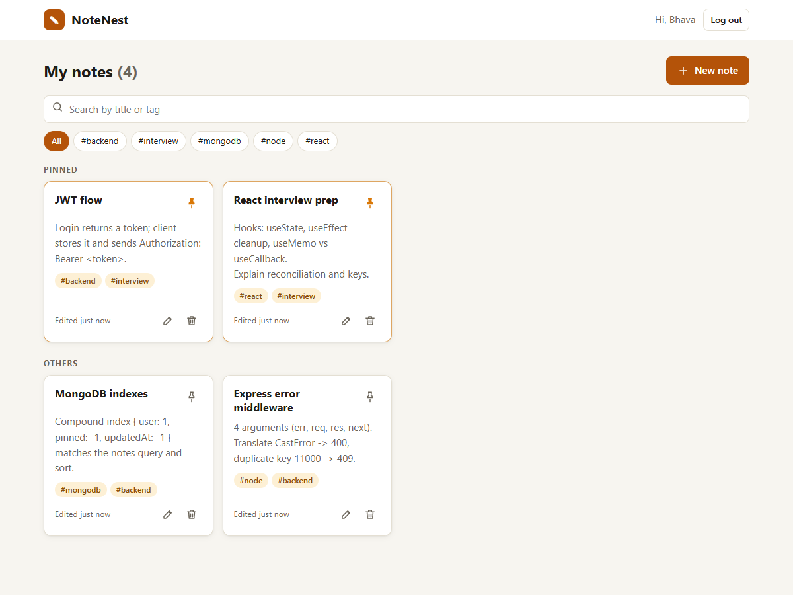
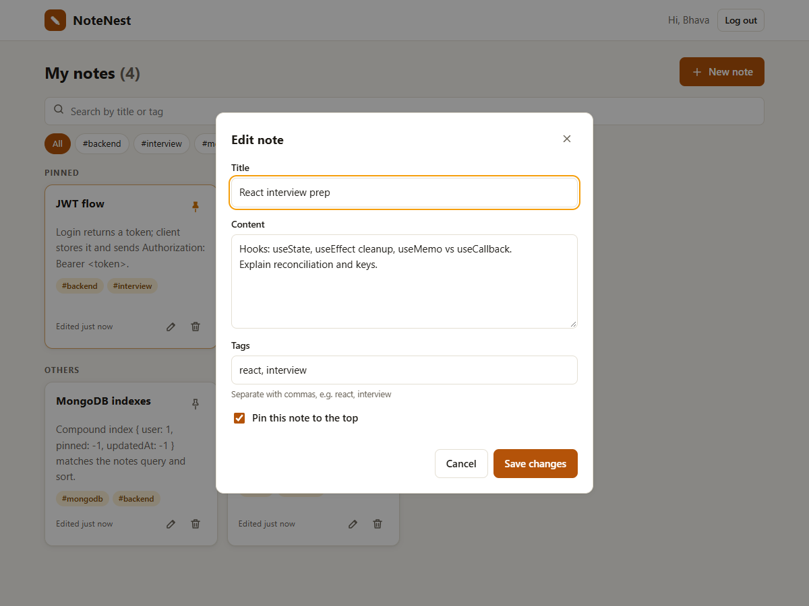
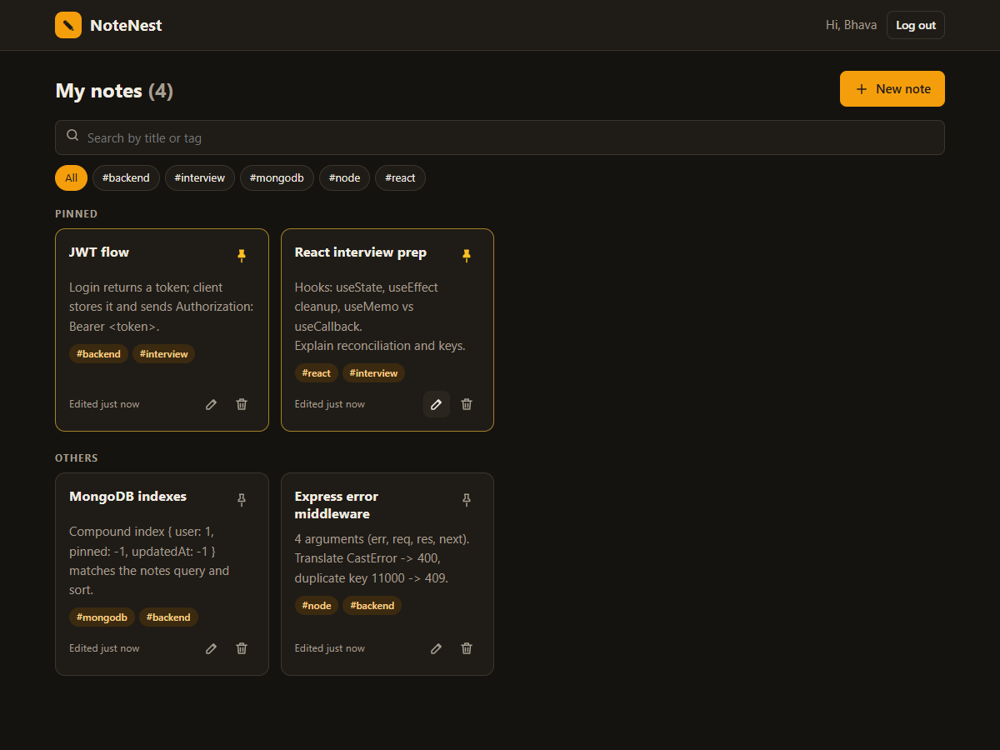
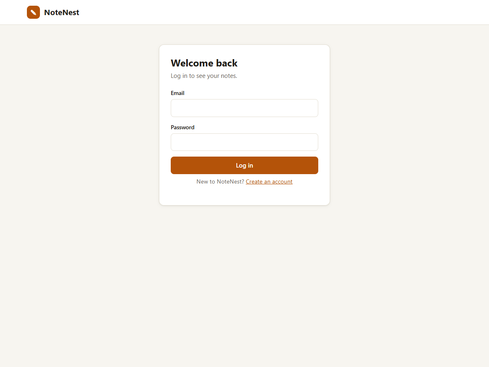
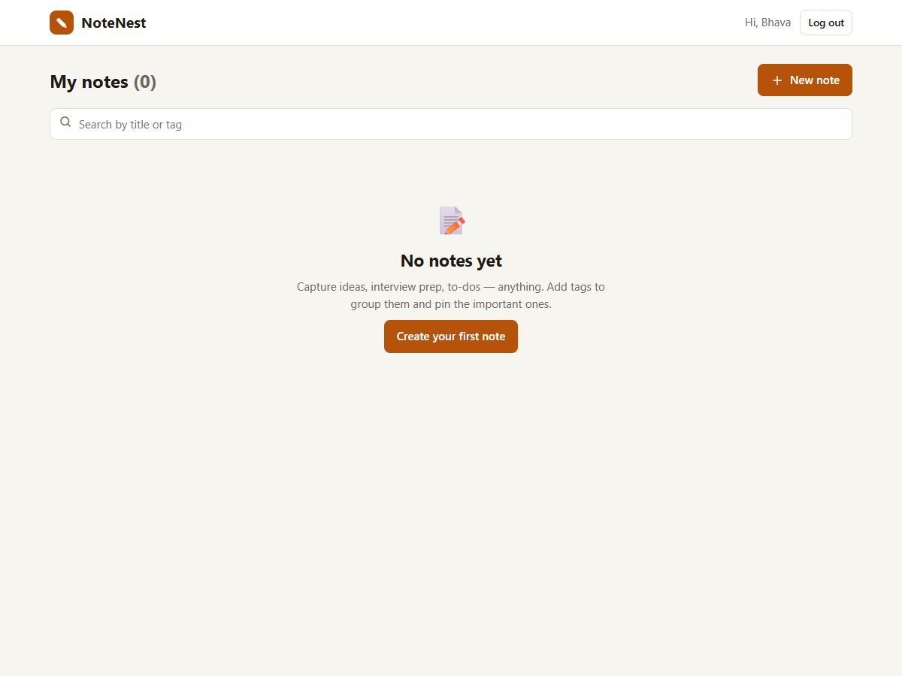
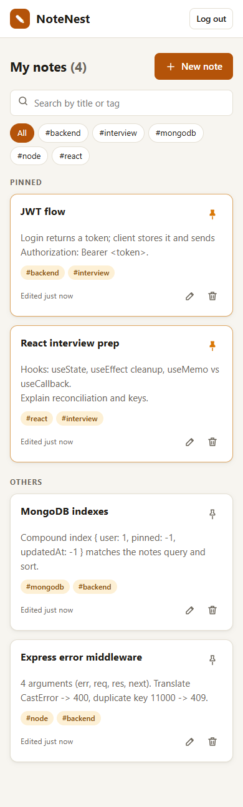

# NoteNest – MERN Notes App

A full-stack notes app built with the **MERN** stack: **MongoDB (Mongoose), Express, React (Vite) and Node.js**.
Sign up, write notes, add tags, pin the important ones, and find anything with search.


## Live demo

> Coming soon: the client on Vercel and the API on Render. Links will be added here after deployment.

## Screenshots



| Edit in a modal | Dark mode |
|---|---|
|  |  |

| Login | Empty state | Mobile |
|---|---|---|
|  |  |  |

## Features

- **Auth:** register and log in with JWT. Passwords are hashed with bcrypt. Protected routes keep your notes private, and refreshing the page keeps you logged in.
- **Notes CRUD:** create, edit and delete notes with a title, content, tags and a pinned flag.
- **Pinning:** pinned notes appear in their own section at the top.
- **Search and filter:** search by title or tag (debounced, case-insensitive), or click a tag chip to filter by it.
- **Validation:** zod on the server, with field errors shown under the matching input in the UI. Mongoose schema rules act as a second check.
- **Error middleware:** every error has the same JSON shape. Bad IDs, duplicate emails and schema errors become clear 4xx responses.
- **UI states:** a loading spinner, "no notes yet" and "no results" messages, and error messages with a retry button.
- **Responsive and accessible:** works on phones, has light and dark themes, and the modal supports the keyboard (Esc closes it, focus stays inside it).

## Tech stack

| Layer | Tools |
|---|---|
| Client | React 19, Vite, React Router 7, plain CSS |
| Server | Node.js 24, Express 5, Mongoose 9, zod, jsonwebtoken, bcryptjs |
| Database | MongoDB 8 (Docker locally, MongoDB Atlas in the cloud) |
| Testing | Node's built-in test runner + Supertest (12 API tests against a real MongoDB) |
| CI / deploy | GitHub Actions; Render (API) + Vercel (client) |

## Project structure

```
notenest-mern/
├── server/                     # Express + MongoDB API
│   ├── src/
│   │   ├── server.js           # connects to MongoDB, then starts the server
│   │   ├── app.js              # Express app: CORS, JSON, routes, error handling
│   │   ├── config/             # env.js (settings), db.js (Mongoose connection)
│   │   ├── models/             # User.js, Note.js (Mongoose schemas)
│   │   ├── controllers/        # auth + notes logic
│   │   ├── routes/             # URL → validation → controller
│   │   ├── validators/         # zod schemas
│   │   ├── middleware/         # auth (JWT), validate, errorHandler
│   │   └── utils/AppError.js   # error with HTTP status + code
│   └── tests/                  # API tests (node --test + Supertest)
├── client/                     # React (Vite) app
│   └── src/
│       ├── api/client.js       # the only file that calls the API
│       ├── context/AuthContext.jsx
│       ├── components/         # Button, Modal, NoteCard, SearchBar, TextField, ...
│       ├── hooks/              # useNotes, useDebounce
│       └── pages/              # LoginPage, RegisterPage, NotesPage, NotFoundPage
├── docker-compose.yml          # local MongoDB
└── render.yaml                 # Render blueprint for the API
```

### Important files in one or two lines

**Server**
- `models/User.js`: the user schema. The password is hashed automatically before saving, and it's never returned in queries (`select: false`).
- `models/Note.js`: the note schema (title, content, tags, pinned, owner) with timestamps. Indexes speed up "my notes, pinned first".
- `controllers/note.controller.js`: CRUD and search. Every query filters by the logged-in user, so other people's notes return 404. Search text is escaped, so it's matched literally.
- `middleware/auth.js`: reads `Authorization: Bearer <token>`, verifies the JWT, and sets `req.userId`.
- `middleware/validate.js`: runs zod schemas on the body, query or params, and returns a 400 listing each bad field.
- `middleware/errorHandler.js`: turns any error into the standard JSON error, including Mongoose's CastError, ValidationError and duplicate-key errors.

**Client**
- `api/client.js`: wraps `fetch`, adds the token, and turns API errors into `ApiError` objects with per-field messages.
- `context/AuthContext.jsx`: stores the logged-in user, checks the saved token on load, and logs out automatically when the token expires.
- `components/ProtectedRoute.jsx`: sends logged-out users to `/login`, and logged-in users away from the login and register pages.
- `components/Modal.jsx`: an accessible dialog (portal, Esc to close, focus trap), reused for the note editor and the delete confirmation.
- `components/NoteCard.jsx`: one note with a content preview, clickable tags, an "edited 5 minutes ago" time, and pin, edit and delete buttons.
- `components/SearchBar.jsx`: a search input with a clear button. `NotesPage` debounces it with `useDebounce`.
- `hooks/useNotes.js`: loads notes and tags, tracks loading, ready and error states, and cancels outdated requests.
- `pages/NotesPage.jsx`: puts it all together: the toolbar, the pinned and other sections, the modals, and the empty and error states.

## API endpoints

Base URL: `http://localhost:5000/api`. Routes marked 🔒 need `Authorization: Bearer <token>`.

| Method | Endpoint | Auth | Description |
|---|---|---|---|
| GET | `/health` | | API and database status |
| POST | `/auth/register` | | `{ name, email, password }` → `{ user, token }` |
| POST | `/auth/login` | | `{ email, password }` → `{ user, token }` |
| GET | `/auth/me` | 🔒 | Current user |
| GET | `/notes?search=&tag=&pinned=` | 🔒 | Your notes, pinned first, then newest |
| GET | `/notes/tags` | 🔒 | All tags you've used |
| POST | `/notes` | 🔒 | Create `{ title, content?, tags?, pinned? }` |
| GET | `/notes/:id` | 🔒 | One note |
| PATCH | `/notes/:id` | 🔒 | Update any fields, e.g. `{ "pinned": true }` |
| DELETE | `/notes/:id` | 🔒 | Delete (204) |

Error format:

```json
{ "error": { "status": 400, "code": "BAD_REQUEST", "message": "Validation failed",
             "details": [{ "field": "title", "message": "Title is required" }] } }
```

## Run it locally

You need **Node.js 20+** and **Docker** (for MongoDB). A local MongoDB install or an Atlas connection string also works.

```bash
# 1. Database
docker compose up -d mongo              # MongoDB on localhost:27017

# 2. API (terminal 1)
cd server
cp .env.example .env                    # Windows PowerShell: Copy-Item .env.example .env
npm install
npm run dev                             # http://localhost:5000/api/health

# 3. Client (terminal 2)
cd client
cp .env.example .env                    # VITE_API_URL=http://localhost:5000/api
npm install
npm run dev                             # http://localhost:5176
```

Run the API tests (MongoDB must be running; they use a separate `notenest_test` database):

```bash
cd server
npm test
```

### Environment variables

| File | Variable | Example | Purpose |
|---|---|---|---|
| `server/.env` | `MONGO_URI` | `mongodb://localhost:27017/notenest` | MongoDB connection (an Atlas `mongodb+srv://` string works too) |
| | `JWT_SECRET` | long random string | Signs login tokens (required in production) |
| | `JWT_EXPIRES_IN` | `7d` | Token lifetime |
| | `CLIENT_ORIGIN` | `*` or `https://notenest.vercel.app` | Websites allowed to call the API (CORS) |
| | `PORT` | `5000` | API port |
| `client/.env` | `VITE_API_URL` | `http://localhost:5000/api` | Where the client sends requests |

## Deployment

1. **MongoDB Atlas:** create a free M0 cluster and a database user, allow access from `0.0.0.0/0`, and copy the `mongodb+srv://` connection string.
2. **Render (API):** go to New → Blueprint and pick this repo. [`render.yaml`](render.yaml) sets up `server/` and generates `JWT_SECRET`. Paste `MONGO_URI`, and set `CLIENT_ORIGIN` to the Vercel URL.
3. **Vercel (client):** import the repo, set Root Directory to `client`, and set `VITE_API_URL=https://<render-service>.onrender.com/api`. [`client/vercel.json`](client/vercel.json) makes refreshes on `/login` or `/register` work.
